# √FENSCER

SHARP PC-1261／PC-1262用の思考型シューティングゲームです。

プレイヤーは、飛行フォーム「AERO」と歩行フォーム「WALKER」を切り替えながら、ステージを攻略します。

ステージには監視機構「SENSOR」が配置されており、プレイヤーの行動を妨害します。
```text
- ゲームはステージクリア形式です。
- FENSCERを操作して、STARTからEXITを目指してください。
- 各ステージは「Level」と「Round」で管理され、1つのLevelは8つのRoundで構成されています。
- Levelは1～8に加え、特別ステージとしてAとBが用意されています。
```
# デモ動画
https://github.com/user-attachments/assets/ac6405a6-c58d-4905-9c88-683a493e3b3f

- デモ動画の収録には、woriguchi氏が公開している sc61box を使用しています。

# 配布ZIPの構成
```text
rootFENSCER/
├── game/    # rootFENSCER本体
├── maps/    # 追加ステージデータ
└── images/  # 操作方法など
```

# 配布ファイル

GitHub Releasesから `rootFENSCER-v<バージョン>.zip` と同名の `.sha256` ファイルをダウンロードできます。ZIPには README、LICENSE、game/、maps/、images/ が含まれます。

両方のファイルを同じディレクトリに置き、SHA256を確認してからZIPを展開してください。例えば、タグが `v0.3.69` の場合は次のコマンドを使用します。

```bash
sha256sum -c rootFENSCER-v0.3.69.zip.sha256
```

# 画面構成
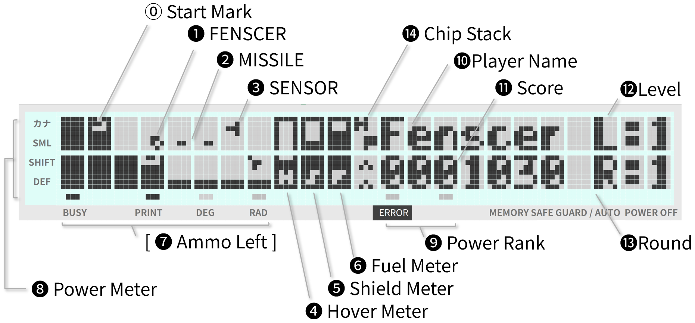

|番号|名称|説明|
|:-:|--:|:--|
|0|Stark Mark|スタート位置です。Sマークが点滅します。FENSCERがここに配置されて始まります。|
|1|FENSCER|Playerが操縦する自機です。**WALKER**（歩行フォーム）と**AERO**（飛行フォーム）を切り替えて操作します。|
|2|MISSILE|FENSCERが撃ったミサイルです。直進します。|
|3|SENSOR|ステージ内に配置された監視機構です。SENSORは全部で15種類あり、4つの属性に分類されています。|
|4|Hover Meter|√FENSCERには、ホバー機構／ワープ機構があります。Hoverは歩行フォームで使用します。上昇にはHoverが必要です。<br>上昇には8キーを使用します。ただし、Hoverが0の場合は上昇できません。<br>歩行フォームでしゃがむとHoverを補充できます。しゃがむには2キーを使用します。<br>歩行時に高さ1段分の段差があり、Hoverが残っている場合は、段差を無視して駆け上がることができます。|
|5|Shield Meter|√FENSCERにはシールド機構があります。Shieldが有効な場合、ダメージを吸収し、本体へのダメージを防ぎます。<br>ダメージを受けるとShieldが減少します。Shieldが0になると、本体が直接ダメージを受けます。Shieldの残量は本メーターで確認できます。|
|6|Fuel Meter|√FENSCERは、燃料が0になるとGAMEOVERです。ダメージを受けると燃料が減少します。<br>燃料はRoundをクリアするたびに少し回復します。また、燃料補給型のSENSORを破壊するとチャージできます。残燃料は本メーターで確認できます。|
|7|Ammo Left|発射可能なミサイル数を表示します。初期値は最大で4です。なお、FENSCER_v3s.wav(BGMあり)では無効です|
|8|Power Meter|ミサイルの威力を表示します。DEFで2倍、SHIFTで4倍、SMLで8倍、カナで16倍を意味します。Power Rankが貯まるとPowerが上昇します。|
|9|Power Rank|アイテムのP-CHIPを獲得するたびに蓄積されます。3つ貯まるとPowerが上昇します。|
|10|Player Name|プレイヤーの名前です。GAME開始時に入力します。|
|11|Score|点数です。**SENSOR**を破壊すると加算されます。1,000点ごとに、破壊した**SENSOR**の種類に応じてアイテム**CHIP**が出現します。|
|12|Level|現在のLevel（階層）を表示します。√FENSCERでは、クリアする最小単位を**Round**（面）、Roundを8つまとめた単位を**Level**（階層）としています。|
|13|Round|現在のRound（面）を表示します。Roundは1から8まであり、8つクリアするたびに次のLevel（階層）のデータを追加読み込みします。|
|14|Chip Stack|取得したアイテム**CHIP**を2つまで表示します。<br>√FENSCERには、アイテム連動機構があります。アイテムを一定規則で続けて取得すると、FENSCERの能力が向上します。<br> 能力が上がる場合は上昇マーク、元に戻る場合は下降マークが下に表示されます。|

# √FENSCERを起動するには
PC-1261またはPC-1262でNEWを実行したあと、ファイル「FENSCER」をCLOADMで読み込んでください。

```text
rootFENSCER/
├── game/FENSCER_v3b.wav  # BGMあり(ミサイル弾数表示なし)
└── game/FENSCER_v3s.wav  # BGMなし(ミサイル弾数表示あり)
```
どちらか一方を選んで読み込んでください。両方ともロードアドレスは `&4000`、
WAV内のファイル名称は `FENSCER` です。配布ZIPには本体2種類と追加ステージ10個、
計12個のWAVが含まれます。

続けて次のCALL文を入力してください。ゲームを一度実行すると、以降は[SHIFT] + [F]で起動できます。

```text
CALL &4000,[オプション]
 B    : BGMをOFF
 S    : SOUND EFFECTをOFF
 C    : CONTINUEモード（ゲームオーバー後、ROUNDが1に戻らず、クリアしたROUNDから再開できます）
 P    : Padモード（ネームエントリで文字コード入力にキーボードを使いません）
 R{n} : 開始ROUNDを指定（Cオプションと併用不可）
```

***

# ゲームをプレイするには
起動するとデモフェーズが始まり、ハイスコア表示とキー操作説明を繰り返します。

デモフェーズ中に**DEF**、**SHIFT**、または**CL**を押すと、ゲームフェーズに移行します。

デモフェーズ中に**DEF** + **Z**を押すと、BASICに戻ります。

ゲームフェーズでは、ネームエントリのあとゲームプレイが始まります。
ネームエントリ中は**DEF** + **Z**を受け付けません。ゲームプレイ中に押すと、デモフェーズに戻ります。

```text
デモフェーズ
├── ハイスコア表示（1位から5位まで）
├── キー操作説明
└── [DEF]／[SHIFT]／[CL] → ネームエントリ

ゲームフェーズ
├── ネームエントリ（[DEF] + [Z]は無効）
└── ゲームプレイ
    └── [DEF] + [Z] → デモフェーズ
```

## ネームエントリーの方法

**通常モード**
```text
左右キー   : カーソル移動
SHIFT + 7 : 英小文字入力モード
SHIFT + 8 : カナ入力モード
CL|ENTER  : CLまたはENTERでネームエントリ終了
その他     : 文字入力

数字、大文字、小文字、カナ入力が可能です。最大で7文字まで入力できます。
```
**PADモード**
```text
2      : 文字コード DOWN
8      : 文字コード UP
4      : 左カーソル移動
6      : 右カーソル移動
CL     : 右カーソル移動
ENTER  : ネームエントリ終了

2キー／8キーで文字コードを選択できます。
```
***

# ゲームの進め方

FENSCERを操作して、**START** から **EXIT** を 目指してください。

- 歩行フォームの**WALKER**と飛行フォームの**AERO**を駆使して移動してください。

- 迷路には、見えない壁 **SECRET_WALL** があります。注意して迷路を進んでください。

- 進行の妨げとなる**SENSOR**は、**MISSILE**などで破壊してください。

- **WARP_GATE**を使うと、攻略に役立つアイテムを直接獲得できることがあります。

- 迷路には、探索のヒントとなるメッセージが隠されていることがあります。

  |Game System|
  |:-:|
  |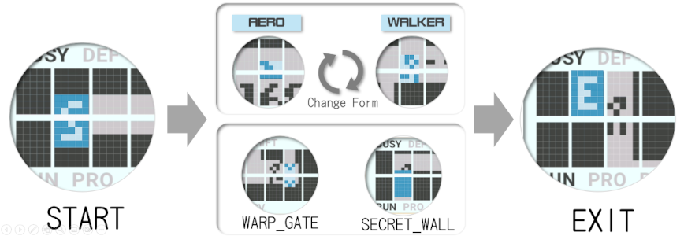 |

## ゲーム中のRoundクリア

EXITに到着するとRoundクリアです。自動的に次のRoundが始まります。
- EXITへの到着方法は[EXIT](#exit)を参照してください。

## ゲーム中のLevelクリア

FENSCERでは、Roundを8つクリアすると、Levelクリアとなります。

- そのあと次のLevelを追加ロードすると、新たなLevelをプレイできます。
- √FENSCERでは、Level 1からLevel 8、およびLevel A、Bをプレイできます。
- 画面にCLOAD {n} Ready? と表示されたら、該当するLevelのwavファイルを準備して Y を押してからwavファイルを再生してください。
- Nを押すと、次のLevelを読み込まず、同じLevelでゲームが再開します。

```text
rootFENSCER/
└── maps/STAGE_X_v3.wav
```

##  ゲーム中のインタラプト

### ゲーム中進行中の一時停止モード
- モードスイッチを **RSV**モードにすると表示がOFFになり一時停止状態を維持します。
- モードスイッチを **RUN**モードに戻すと約2秒でゲームが再スタートします

### ゲームだけを終了させる方法
　ゲーム中に **DEF** + **Z** を入力してください。ゲームが中断し デモフェーズに戻ります。

### FENSCERそのものを終了させる方法
　ゲーム中に 電源を**OFF**にしてください。ゲームが中断し電源が切れます。電源を入れると**BASIC**に戻ります。


***

#  ゲームの操作方法


## WALKER（歩行フォーム）とAERO（飛行フォーム）

FENSCERには、歩行フォームのWALKERと飛行フォームのAEROがあります。

- 3x5 dotの**WALKER**（歩行フォーム）と5x3 dotの**AERO**（飛行フォーム）です。

- **WALKER**には、歩行姿勢としゃがみ姿勢（CROUCH）があります。

- フォームによって移動できる範囲が異なります。

  下図を参考に、地形に応じて適切なフォームを選択してください。

  | Move Zone|
  |:-:|
  |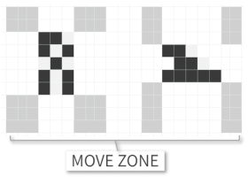 |


## WALKERの移動方法（歩行フォーム）

- 左右キーを押している間、その方向へ移動します。

  壁がある場合は移動を停止します。ただし、AEROフォームとは異なり、ダメージを受けることはありません。
- 上昇も可能です。ただし、Hoverが**0**の場合は上昇できません。

  その場でしゃがんでHoverを補充してください。

- また、進行方向に段差があっても、1段差かつHoverが残っている場合は駆け上がれます。

```text
4     : 左へ方向転換します。方向転換後、歩行して前進します。
6     : 右へ方向転換します。方向転換後、歩行して前進します。
8     : 上へ上昇。ただしHoverが0の場合、上昇できません。
2     : しゃがむ。
      : 足元に地面がない場合は、自由落下します。
```

  |Walker Form|Crouch Form|Hover Meter|
  |:-:|:-:|:-:|
  |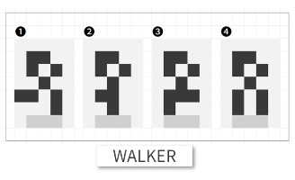 |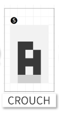 |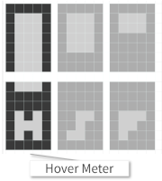 |

## AEROの移動方法（飛行フォーム）

- WALKERの2倍の速度で前方に移動します。左右キーを押さなくても自動的に進みます。
- ただし前方に壁がある場合、注意が必要です。<br>
  この場合、進行方向の壁に**衝突している**とみなされ、微妙ですがダメージを受け**続けている**状態になります。
```text
4     : 左へ方向転換します。方向転換後、自動的に前進します。
6     : 右へ方向転換します。方向転換後、自動的に前進します。
8     : 上へ上昇します。
2     : 下へ下降します。
      : 進行方向に壁がある場合、継続的にダメージを受けてしまいます。
```

   |Aero Form|
   |:-:|
   |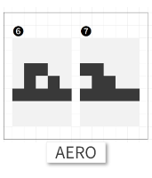 |

# フォームチェンジ

FENSCERには、変形機構があります。

- 変形キーを押すたびに双方のタイプが入れ替わります。
- しかし地形によって変形ができないことがあります。その場合は変形がキャンセルされて元のタイプに自動的に戻ります。

  下図のように変形後の空間を確認し、適切にフォームチェンジしてください。

- 以前のFENSCERでは地形とぶつかった場合、無条件にキャンセル動作となっていました。

  しかし√FENSCERではアジャスター機能によって自機の位置をずらした変形が可能となっています。
```text
CL      : 変形キーです
　      : WALKERとAEROを相互にフォームチェンジします
```
  |Form Change (1)(2)(3)(4)(5)(6)(7)|Form Zone|
  |:-:|:-:|
  |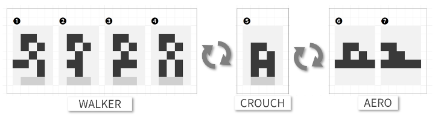| 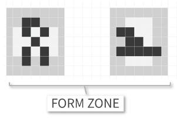|


# ミサイル

FENSCERには、ミサイル機構があります。ミサイルを発射して、**SENSOR**にダメージを与えます。

- ダメージ量は**Power**で換算され、初期値は1です。

- **Power**は、アイテム（P-CHIP）を獲得することで上昇させることができます。

- ミサイルは単射モードが基本です。アイテムの組み合わせで連射モードに強化できます（逆に退化することもあります）。

- ミサイルの残弾数は、初期モードで4発です。アイテムの組み合わせで残弾数を増やせます(最大で8発)。

- WALKERの歩行姿勢／CROUCH姿勢／AEROの違いによって、ミサイル軌道の高さが変わります。詳しくは下図を参照してください。

```text
DEF   : 発射キーです。
      : ミサイルを1発発射します。
      : WALKERの歩行姿勢／CROUCH姿勢／AEROの違いによって、ミサイル軌道の高さが変わります。
```

|Missile Point (1) (2) (3)|
|:-:|
|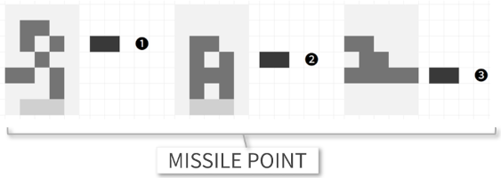|

# シールド

FENSCERには、シールド機構があります。シールド機能が有効な場合、シールドがダメージを吸収し本体へのダメージを防ぎます。

- ShieldはShield Meterで確認できます。詳しくは下図を参照してください。

- SENSORに攻撃されると、FENSCERはダメージを受けます。

　　　同時に SENSORにも ダメージを **1** 与えます。

- ダメージを受けるとShieldが減少します。Shieldが0になると、本体が直接ダメージを受けます。

- Shieldを補給するには、補給キーを使います。燃料を1ゲージ消費してShieldをMAXにします。

- 燃料が1ゲージ以下の場合は、Shieldを補給できません。
- Shieldが3ゲージ以上ある場合は、補給されません（補給不要）。

　燃料の残量はFuel Meterで確認できます。詳しくは下図を参照してください（中央のSの部分です）。

- Shieldが2ゲージを下回ると、警告音が鳴り続けます。注意してください。

```text
SHIFT  : 補給キーです。
       : 燃料を1ゲージ消費してShieldをMAXにします。
       : Fuelが1ゲージ以下だと、Shieldを補給できません（補給不可）
       : Shieldが3ゲージ以上だと、補給されません（補給不要）
```

   |Shield Meter|Fuel Meter|
   |:-:|:-:|
   |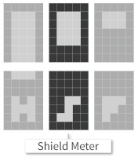 |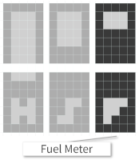|


# GAMEシステム

## START

FENSCERの初期位置です。

- LEVELごとに開始位置が異なります。

- FENSCERはここからEXITを探索して進みます。

- 短い周期で点滅しています

  |Start Mark|
  |:-:|
  |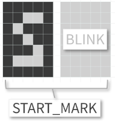　|


## EXIT

そのステージの出口です。

- 自分の位置をブロックの**中央**に合わせてください。AEROでもWALKERでもゴールできます。

    詳しくは下記の図を参考にしてください。　　

- 通常は、短い周期で点滅しています。

   しかし、出口が隠されていることがあります。この場合、とても長い周期で一瞬だけ点滅します。注意深く見つけてください。

  |Exit Mark|Exit Zone|
  |:-:|:-:|
  |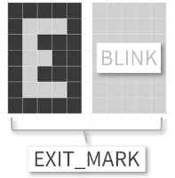|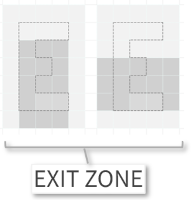|


## SECRET WALL

通過できる地形を 黒い壁"▮"で覆い隠し、迷路探索を妨げます。

- 隠される地形の形はさまざまです。そのため、フォームによっては通過できないこともあります。

- 点滅はしません。

  |Secret Wall Mark|
  |:-:|
  |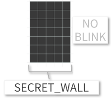|　

## WARP GATE

**Hover**を使って、別の場所（別ステージのどこか）にワープします。

- WARP GATEブロックの**中央**で、しゃがんでください。

　　　詳しくは下記の図を参考にしてください。
- Hoverが**MAX**になると、Hoverをすべて消費してワープします。
- ワープは**return**であっても、しゃがめれば 元の場所に戻れます。
- ワープ先には アイテム(CHIP)が隠されていることがあります。
- 長い周期で点滅しています。注意深く見つけてください。　

     |Warp Gate Mark|Hover Meter|
     |:-:|:-:|
     |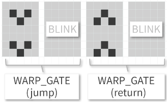　||

     |Warp Zone | Crouch Style|
     |:-:|:-:| 
     |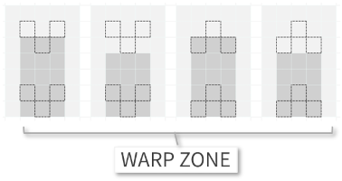 | |


# SENSOR

FENSCERの進行を阻む 監視機構です。TYPE-H / TYPE-P /TYPE-F /TYPE-S と4つの種類があります。

- SENSORには、**MISSILE**や**ATTACK**（体当たり）でダメージを与えられます。
  
  SENSORごとに**耐久値**が設定されており、蓄積されたダメージが耐久値を超えると破壊されます。

- SENSORの **TYPE-S** を破壊した場合は、**Shield**が**MAX**に補充され、SENSORごとに一定値のFuelがチャージされます。

  耐久値が大きいSENSORほどチャージ量も大きくなります。

- SENSORを破壊すると、SENSORごとにポイントが加算されます。 

  ポイントが1000点を超えるたびに **CHIP** と呼ばれる アイテムが 出現します。

  **CHIP** の種類に応じて、さまざまな効果を得ることができます

|NAME|説明|TYPE|
|:--|:--|:-:|
|H-RWT|巡回型で、右手 の壁に沿って移動|TYPE-H|
|H-LWT|巡回型で、左手 の壁に沿って移動|〃|
|H-RRT|巡回型で、壁に接触したら進行方向に対して右に方向転換して移動|〃|
|H-LRT|巡回型で、壁に接触したら進行方向に対して左に方向転換して移動|〃|
|P-DART|巡回型で、右斜方向に直進し、壁に衝突すると方向転換|TYPE-P|
|P-RAY|巡回型で、左方向に直進し、壁に衝突すると方向転換|〃|
|P-WALL|追尾型で、横方向を追尾、縦方向は直進し壁に衝突すると方向転換|〃|
|P-WAVE|追尾型で、縦方向を追尾、横方向は直進し壁に衝突すると方向転換|〃|
|F-CHIP|静止型で、破壊されたら特殊効果を得られる|TYPE-F|
|F-DELT|追跡型で、FENSCERの周囲の壁に沿いながら追尾|〃|
|F-TRBL|追跡型で、全方向でFENSCERを追尾|〃|
|F-EGG|追跡型で、FENSCERの周辺をゆらゆらと追尾|〃|
|S-EYE|静止型で、破壊すると Shield MAX補充 + Fuel 0.5ゲージ補充|TYPE-S|
|S-WINK|一定周期で、静止型と追尾型(F-TRBL)に変化。破壊すると Shield MAX補充 + Fuel 1ゲージ補充|〃|
|S-JWEL|静止型で、破壊すると Shield MAX補充 + Fuel 2ゲージ補充|〃|

|SENSOR TYPE|
|:-:|
|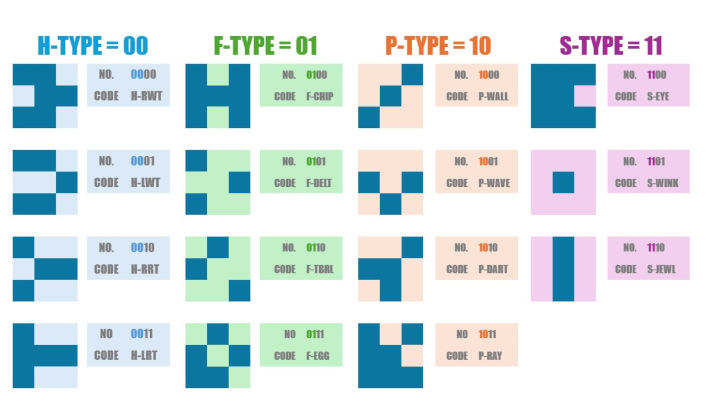|

# CHIP

ポイントが1000点を超えるたびに 出現する アイテムです。
- CHIPは4つの種類があり、種類に応じて、さまざまな効果を得ることができます
- 単独効果は、獲得した時点で効果が発揮します。
- 連続効果は、CHIPの取得順番に応じて効果を発揮します。

  連続効果が適用された時は、Chip Stackの下に上昇 or 下降エフェクトが表示されます。

### 単独効果

   |種別|名称|説明|出現条件|
   |:-:|---|:--|:-:|
   |H|Hover CHIP|Hoverを一定期間MAXにします。その間Hover Meterが点滅します。|SENSORがTYPE-Hのときに出現。|
   |P|Power CHIP|Power Rankを1上昇させます。<br>Power Rankが3になるとPowerが上昇します。最大で4段階まで上昇します。|SENSORがTYPE-Pのときに出現。|
   |F|Fuel CHIP|Fuelを4ゲージ補給します。|SENSORがTYPE-Fのときに出現。|
   |S|Shield CHIP|Shieldを一定期間MAXにします。その間、Shield Meterが点滅します。|SENSORがTYPE-Sのときに出現。|

### 連続効果

|1st|2nd|強化効果|名称|
|:-:|:-:|---|---|
|H|P|弾丸**加速**|Hyper|
|F|S|弾丸**連射**|Full Shooting|
|P|S|弾数**追加**|Plus Shooting|
|F|F|移動**加速**|Fast Moving|

|1st|2nd|退化効果|名称|
|:-:|:-:|---|---|
|P|H|弾丸**減速**|unHyper|
|S|F|弾丸**単射**|unFull Shooting|
|S|S|移動**減速**|Slow Moving|

# 謝辞
本プロジェクトでは、解析や動作確認、デモ動画作成のために、以下の公開ツールを利用しています。
- [SC61860 CROSS ASSEMBLER /DISASSEMBLER](https://hd61700.yukimizake.net/SC61860/index.html) (yukimizake)
- [Pokecom GO](https://github.com/digihori/pokecom) (digihori )
- [Pokecom GO Plus](https://github.com/digihori/pokecom-go-plus) (digihori )
- [sc61box](https://github.com/woriguchi/sc61box) ( woriguchi)

これらのツールおよび関連情報を GitHub や Web サイトで公開してくださっている 作者の皆様に深く感謝いたします。

本リポジトリで公開しているスクリーンショット、デモ動画の作成において、 これらの成果物から多大な恩恵を受けました。

# 免責事項

本作品は「THEXDER」に影響を受けて制作したオリジナル作品です。
THEXDERの著作権者・商標権者とは一切関係ありません。
