# √FENSCER

SHARP PC-1261/1262用の思考型シューティングゲームです。

飛行フォルムと歩行フォルムを上手く切り替えて、センサーと呼ばれる監視機構を排除しながら複数のステージ(Round)を攻略してください。
```text
- ステージはLEVEL1からLEVEL8までの8つのLEVELで構成
- それぞれのLEVELが ROUND1～ROUND8までの8つのROUNDで構成
- 各LEVELではFENSCERを操作して START → ENTERを目指す
```


# リポジトリ構成
```text
rootFENSCER/
├── game/    # rootFENSCER本体
├── maps/    # 追加ステージデータ
└── images/  # 操作方法など
```

# 画面構成
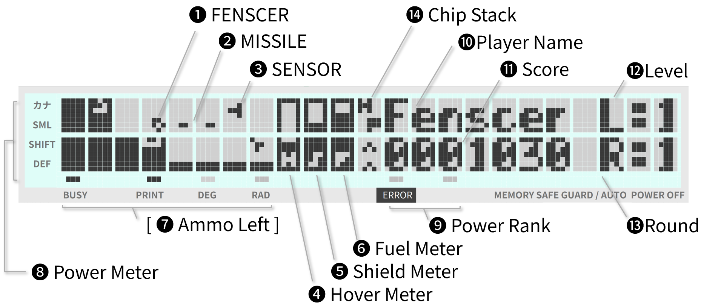

|番号|名称|説明|
|:-:|--:|:--|
|0|Stark Mark|スタート位置です。Sマークが点滅します。FENSCERがここに配置されて始まります。|
|1|FENSCER|Playerが操縦する自機です。**WALKER**(歩行フォーム)と**AERO**(飛行フォーム)の形態があります。|
|2|MISSILE|FENSCERが撃ったミサイルです。直進します。|
|3|SENSOR| 監視機構です。TYPE-H/TYPE-P/TYPE-F/TYPE-Sと4つの種類があります。|
|4|Hover Meter|√FENSCERには、ホバー機構/ワープ機構があります。歩行フォームの場合に使用します。歩行フォームでの上昇にはホバーが必要です。<br>上昇は8キーを使用します。しかしホバーが0になっている場合は上昇できません。<br>補充には 歩行フォームでしゃがんで蓄積します。しゃがむには2キーを使用します。<br>歩行時に、高さが1段差 かつ ホバーがある場合は、段差を無視して駆け上がることが可能です。|
|5|Shield Meter|√FENSCERには、シールド機構があります。シールド機能が有効な場合、シールドがダメージを吸収し本体へのダメージを防ぎます。<br>ダメージを受けると減少します。耐久値が0になった場合は、本体が直接ダメージを受けてしまいます。本メータで耐久値を確認できます。|
|6|Fuel Meter|√FENSCERは、燃料が0になるとGAMEOVERです。ダメージを受けると減少します。<br>燃料は ROUNDをクリアするたびに少し回復します。もしくは燃料補給型のセンサーを破壊することでチャージできます。本メータで残燃料を確認できます。|
|7|Ammo Left|発射可能なミサイル数を表示します。初期値は最大で4です。|
|8|Power Meter|ミサイルの威力を表示します。DEFで2倍、SHIFTで4倍、SMLで8倍、カナで16倍を意味します。Power Rankが貯まると上昇していきます。|
|9|Power Rank|アイテムのP-CHIPを獲得するたびに蓄積されます。3つ貯まると Power値が上昇します。|
|10|Player Name|プレイヤーの名前です。GAME開始時に入力します。|
|11|Socre|点数です。**SENSOR**を破壊すると加算されます。1,000点毎に破壊した**SENSOR**の種類に応じてアイテム**CHIP**が出現します。|
|12|Level|現在のLevel(階層)を表示します。√FENSCERではクリアする最小単位を**Round**(面)、Roundを8つまとめた単位を**Level**(階層)としています。|
|13|Round|現在のRound(面)を表示します。Roundは1から8まであり、8つクリアするたびに次Level(階層)のデータを追加読み込みしていきます。|
|14|Chip Stack|取得したアイテム**CHIP**を2つまで表示します。<br>√FENSCERには、アイテム連動機構があります。アイテムを一定規則で続けて取得すると、FENSCERの能力が向上します。<br> 能力が上がる場合は上昇マーク、元に戻る場合は下降マークが下に表示されます。|

# √FENSCERを起動するには
NEWを実行したのち、ファイル "FENSCER"を CLOADM で 読み込んでください。

```text
rootFENSCER/
└── games/90FENSCER_XXXX-4000.wav 
```
次のCALL文を入力してください。
一度実行をすると、以降は [SHIFT] + [F] で 起動ができるようになります。

```text
CALL &4000,[オプション]
 B    : BGM を OFF
 S    : SOUND EFFECT を OFF
 C    : CONTINUEモード (ゲームオーバー後、ROUNDが1に戻りません。クリアしたROUNDからゲームを再開できます）
 P    : Padモード (ネームエントリで文字コード入力にキーボードを使いません)
 R{n} : 開始ROUND を 指定 (Cオプション併用不可)
```

***

# ゲームをプレイするには
起動をするとデモフェーズとしてハイスコアとキー操作のループが始まります。

デモフェーズ中に、**DEF** / **SHIFT** / **CL** の入力で,ゲームフェーズに移行しゲームが開始されます。

```text
デモフェーズ/
├── ハイスコア表示/  # 1位から5位までを表示する
├── キー操作説明/    # キー操作を表示する
├── デモフェーズへ/  # [DEF][SHIFT][CL]キー入力がなければデモフェーズに戻る
│　　               # [DEF]+[Z]の場合はBASICに戻ります。　
ゲームフェーズ/
├── ネームエントリ/  # プレイヤー名を入力する
├── ゲームプレイ/    # ゲームを開始する
└── デモフェーズへ/  # デモフェーズに戻る　
```

## ネームエントリーの方法

**通常モード**
```text
カーソル　 : 左右にカーソル移動
SHIFT + 7 : 英小文字入力モード
SHIFT + 8 : カナ入力モード
ENTER     : ネームエントリ終了
CL|ENTER  : ネームエントリ終了
その他     : 文字入力

数字、大文字、小文字、カナ入力が可能です。最大で7文字まで入力できます。
```
**PADモード**
```text
2      : 文字コード DOWN
8      : 文字コード UP
4      : 左カーソル 移動
6      : 右カーソル 移動
CA     : 右カーソル 移動 
ENTER  : ネームエントリ終了

上下キーで文字を指定可能です
```
***

# ゲームの進め方

FENSCERを操作して、**START** から **EXIT** を 目指してください。

- 歩行フォルム-**WALKER** と 飛行フォルム-**AERO** を 駆使して移動をしてください。

- 迷路には 見えない壁 **SECRET_WALL** があります。注意をして迷路を解いてください

- 進行の妨げとなる**SENSORS**は MISSILEなどで駆逐してください。

- **WATP_GATE** を使えば 攻略が有利になるアイテムを直接獲得できることがあります。

- 迷路には 探索のヒントとなる メッセージ が 隠されているこがあります

  |Game System|
  |:-:|
  |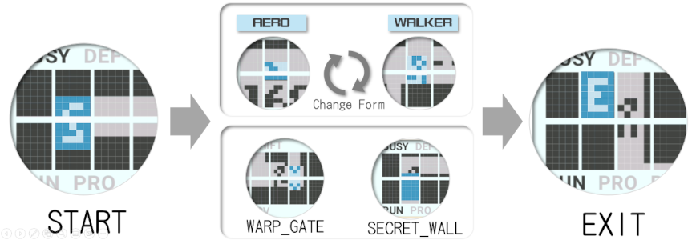 |

##  ゲーム中の Round クリア

EXITに到着すると、Round クリアです。自動的に 次Roundが開始されます。
- EXITへの到着方法は EXITを参照してください

##  ゲーム中の Level クリア

FENSCERでは、Round を 8つクリアすると、1 Levelクリアとなります。

- そのあと 次レベル を 追加ロードすることで 新たな Level をプレイすることが可能です。

   Stageデータはmapsフォルダに格納されています。

   STAGE_XX_*-5F00.wav

   XXがLevelを指します。
   

- √FENSCERでは、Level1からLevel8、LevelA,Bまでをプレイすることができます。
- 画面にCLOAD {n} Ready? と表示されたら、該当するLevelのwavファイルを準備して Y を押してからwavファイルを再生してください。
- Nを押すと、次Levelを読み込まず、同じLevelでGameが再開します。

```text
rootFENSCER/
└── maps/STAGE_XX_*-5F00.wav
```

##  ゲーム中のインタラプト

### ゲーム中進行中の一時停止モード
- モードスイッチを **RSV**モードにすると表示がOFFになり一時停止状態を維持します。
- モードスイッチを **RUN**モードに戻すと約2秒でゲームが再スタートします

### ゲームだけを終了させる方法
　ゲーム中に **DEF** + **Z** を入力してください。ゲームが中断し デモフェーズに戻ります。

### FENSCERそのものを終了させる方法
　ゲーム中に 電源を**OFF**にしてください。ゲームが中断し電源が切れます。電源を入れると**BASIC**に戻ります。


***

#  ゲームの操作方法


## WALKER(歩行フォルム)とAERO(飛行フォルム)

FENSCERには、2つの形態があります。

- 3x5dotの**WALKER**(歩行フォルム) と 5x3dotの**AERO**(飛行フォルム) です。

- **WALKER**(歩行フォルム)には、**歩く姿勢**と **しゃがむ姿勢** を準備しています。

- それぞれの形態によって移動できる範囲に違いがあります。

  下図を参考に、地形に応じて適切な形態を選択してください

  | Move Zone|
  |:-:|
  |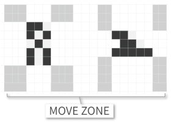 |


## WALKERの移動方法　(歩行フォルム)

- 左右キーを押している間、その方向へ移動します。

  壁がある場合は移動を停止します。ただし AEROフォルムとは違いダメージを受けることはありません。
- 上昇も可能です。ただし Hover残量が**0**の場合は上昇できません。

  その場でしゃがんでHoverを補充してください。

- また進行方向に段差があっても、1段差かつHover残量がある場合は、駆け上がることが可能です。

```text
4     : 左へ方向転換します。方向転換後、歩行して前進します。
6     : 右へ方向転換します。方向転換後、歩行して前進します。
8     : 上へ上昇。ただし Hoverが0の場合、上昇できません。
2     : しゃがむ。
      : 足元に地面がない場合は、自由落下します。
```

  |Walker Form|Crouch Form|Hover Meter|
  |:-:|:-:|:-:|
  |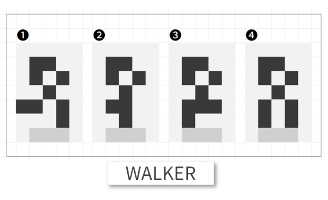 |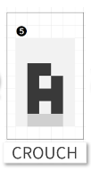 |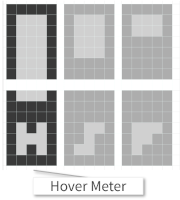 |

## AEROの移動操作方法　 (飛行フォルム)

- 歩行タイプの2倍の速度で前方に移動します。前方には左右キーを押さなくても自動的に進みます。
- ただし前方に壁がある場合、注意が必要です。<br>
  この場合、進行方向の壁に**衝突している**とみなされ、微妙ですがダメージを受け**続けている**状態になります。
```text
4     : 左へ方向転換します。方向転換後、自動的に前進します。
6     : 右へ方向転換します。方向転換後、自動的に前進します。
8     : 上へ上昇します。
2     : 下へ下降します。
      : 進行方向に壁がある場合、継続的にダメージを受けてしまいます。
```

   |Aero Form|
   |:-:|
   |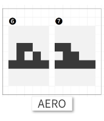 |

# フォルムチェンジ

FENSCERには、変型機構があります。

- 変形キーを押すたびに双方のタイプが入れ替わります。
- しかし地形によって変形ができないことがあります。その場合は変形がキャンセルされて元のタイプに自動的に戻ります。

  下図のように変形後の空間を確認し、適切にフォルムチェンジをしてください。

- 以前のFENSCERでは地形とぶつかった場合、無条件にキャンセル動作となっていました。

  しかし√FENSCERではアジャスター機能によって自機の位置をずらした変形が可能となっています。
```text
CA 　　 : 変形キーです
　      : WALKER と AERO を双方向で　フォルムチェンジをします
```
  |Form Change (1)(2)(3)(4)(5)(6)(7)|Form Zone|
  |:-:|:-:|
  |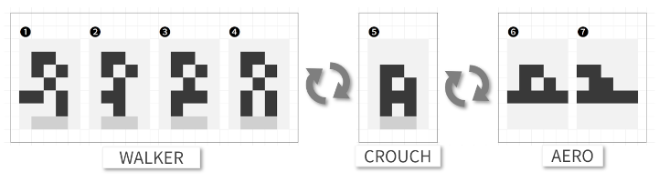| 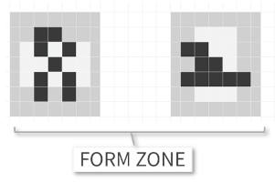|


# ミサイル

FENSCERには、ミサイル機構があります。ミサイルを発射して、**SENSOR**にダメージを与えます。

- ダメージ量は**Power**で換算され、初期値は1です。

- **Power**は、アイテム(P-CHIP)を 獲得することで上昇させることができます。

- ミサイルは単射モードが基本です。アイテムの組わせで連射モードに強化できます(逆に退化もあります)。

- ミサイルの残弾数は、初期モードで4発です。アイテムの組み合わせで残弾数を増やせます(最大で8発)。

- WALKER / CRONCH / AERO フォルムの違いで ミサイル軌道の高さが変わります。 詳しくは下記の図を参照してください。

```text
DEF   : 発射キーです。
      : ミサイルを1発発射します。
      : WALKER / CRONCH / AERO フォルムの違いで ミサイル軌道の高さが変わります。
```

|Missle Point (1) (2) (3)|
|:-:|
|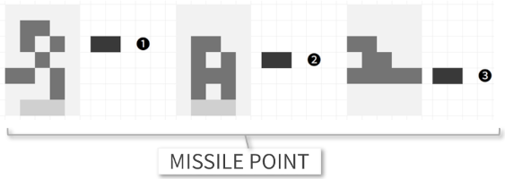|

# シールド

FENSCERには、シールド機構があります。シールド機能が有効な場合、シールドがダメージを吸収し本体へのダメージを防ぎます。

- シールドの耐久値は Shield Meter で確認できます。　詳しくは下図を参照してください）。

- SENSORにアタックされると FENSCERはダメージを受けます。

　　　同時に SENSORにも ダメージを **1** 与えます。

- FENSCERでは、シールド機構があります。シールド機能が有効な場合、シールドがダメージを吸収し本体へのダメージを防ぎます。

- ダメージを受けると耐久値が減少します。耐久値が0になった場合は、本体が直接ダメージを受けてしまいます。

- シールドを補給するには 補給キーを使います。燃料を1ゲージ消費して耐久値をMAXにします。

- 燃料が少ない場合、耐久値が3ゲージ以上ある場合は、シールドチャージは行われません。

　 燃料の残量は Fuel Meterで確認できます。詳しくは下図を参照してください(中央のSの部分です）。

- シールドの耐久値が2ゲージを下回ると、常に警告音が鳴り続きます。注意を払ってください。

```text
SHIFT  : 補給キーです。
       : 燃料を 1ゲージ 消費して 耐久値をMAXにします。
       : 燃料　が1ゲージ以下だと、耐久値のチャージは行われません(チャージ不可)
       : 耐久値が3ゲージ以上だと、耐久値のチャージは行われません(チャージ不要)
```

   |Shield Meter|Fuel Meter|
   |:-:|:-:|
   |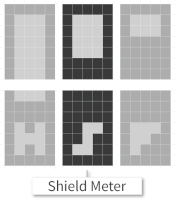 |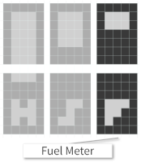|


# GAMEシステム

## START

FENSCERの初期位置です。

- LEVELごとに開始位置が異なります。

- FENSCERはここからEXITを探索して進みます。

- 短い周期で点滅しています

  |Start Mark|
  |:-:|
  |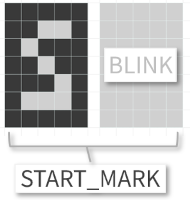　|


## EXIT

そのステージの出口です。

- 自分の位置をブロックの**中央**に合わせてください。AEROでもWALKERでもゴールできます。

    詳しくは下記の図を参考にしてください。　　

- 通常は、短い周期で点滅しています。

   しかし、出口が隠されていることがあります。この場合、とても長い周期で一瞬だけ点滅します。注意深く見つけてください。

  |Exit Mark|Exit Zone|
  |:-:|:-:|
  |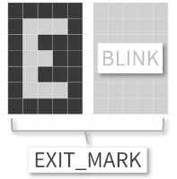|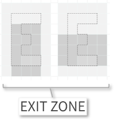|


## SECRET WALL

通過できる地形を 黒い壁"▮"で覆い隠し、迷路探索を妨げます。

- 隠される地形の形は様々です。そのため フォルムの違いで通過できないこともあります。

- 点滅はしません。

  |Secret Wall Mark|
  |:-:|
  |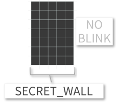|　

## WARP GATE

**Hover残量** を 使って、別の場所(別ステージのどこか)にワープします。

- WARP GATEブロックの**中央**で、しゃがんでください。

　　　詳しくは下記の図を参考にしてください。
- Hover値が **MAX**になると、Hoverをすべて消費してワープします。
- ワープは**return**であっても、しゃがめれば 元の場所に戻れます。
- ワープ先には アイテム(CHIP)が隠されていることがあります。
- 長い周期で点滅しています。注意深く見つけてください。　

     |Warp Gate Mark|Hover Meter|
     |:-:|:-:|
     |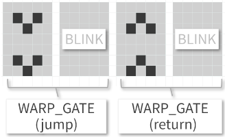　||

     |Warp Zone | Crouch Style|
     |:-:|:-:| 
     |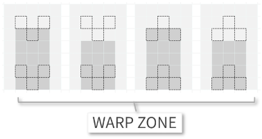 | |


# SENSOR

FENSCERの進行を阻む 監視機構です。TYPE-H / TYPE-P /TYPE-F /TYPE-S と4つの種類があります。

- SENSORSには **MISSILE** や **ATTACK**(体当たり)で ダメージを与えられます。
  
  SENSORごとに**耐久値**が設定されており、蓄積されたダメージが耐久値を超えると破壊されます。

- SENSORの **TYPE-S** を破壊した場合は、**Shield**が**MAX**に補充され、SENSORごとに一定値のFuelがチャージされます。

  耐久値が大きいSENSORほどチャージ量も大きくなります。

- SENSORを破壊すると、SENSORごとにポイントが加算されます。 

  ポイントが1000点を超えるたびに **CHIP** と呼ばれる アイテムが 出現します。

  **CHIP** の種類に応じて、さまざまな効果を得ることができます

|NAME|説明|TYPE|
|:--|:--|:-:|
|H-RWT|巡回型で、右手 の壁に沿って移動|TYPE-H|
|H-LWT|巡回型で、左手 の壁に沿って移動|〃|
|H-RRT|巡回型で、壁に聖徳したら進行方向に対して 右 に方向転換して移動|〃|
|H-LRT|巡回型で、壁に聖徳したら進行方向に対して 左 に方向転換して移動|〃|
|P-DART|巡回型で、右斜方向に直進し、壁に衝突すると方向転換|TYPE-P|
|P-RAY|巡回型で、左方向に直進し、壁に衝突すると方向転換|〃|
|P-WALL|追尾型で、横方向を追尾、縦方向は直進し壁に衝突すると方向転換|〃|
|P-WAVE|追尾型で、縦方向を追尾、横方向は直進し壁に衝突すると方向転換|〃|
|F-CHIP|静止型で、破壊されたら特殊効果を得られる|TYPE-F|
|F-DELT|追跡型で、FENSCERの周囲の壁に沿いながら追尾|〃|
|F-TRBL|追跡型で、全方向でFENSCERを追尾|〃|
|F-EGG|追跡型で、FENSCERの周辺をゆらゆらと追尾|〃|
|S-EYE|静止型で、破壊すると Shield MAX補充 + Fuel 0.5ゲージ補充|TYPE-S|
|S-WINK|一定周期で、静止型と追尾型(F-TRBL)に変化。破壊すると Shield MAX補充 + Fuel 1ゲージ補充|〃|
|S-JWEL|静止型で、破壊すると Shield MAX補充 + Fuel 2ゲージ補充|〃|

|SENSOR TYPE|
|:-:|
|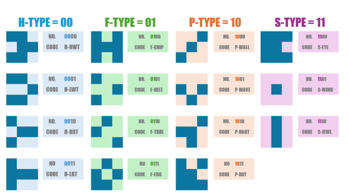|

# CHIP

ポイントが1000点を超えるたびに 出現する アイテムです。
- CHIPは4つの種類があり、種類に応じて、さまざまな効果を得ることができます
- 単独効果は、獲得した時点で効果が発揮します。
- 連続効果は、CHIPの取得順番に応じて効果を発揮します。

  連続効果が適用された時は、Chip Stackの下に上昇 or 下降エフェクトが表示されます。

### 単独効果

   |種別|名称|説明|出現条件|
   |:-:|---|:--|:-:|
   |H|Hover CHIP|Hover残量を一定期間MAXにします。その間Hover Meterが点滅します。|SENSORが TYPE-Hの時に出現。|
   |P|Powe CHIP|Power RANKを1上昇します。<br>Power RANKが3になると、Power値が上昇します。最大で4段階まで上昇します。|SENSORがTYPE-Pの時に出現。|
   |F|Fuel CHIP|Fuel燃料を4ゲージチャージします。|SENSORがTYPE-Hの時に出現。|
   |S|Shield CHIP|Sheild耐久値を一定期間MAXにします。その間SheildMeterが点滅します。|SENSORがTYPE-Sの時に出現。|

### 連続効果

|1st|→|2nd|強化効果|名称|
|:-:|:-:|:-:|---|---|
|H|→|P|弾丸**加速**|Hyper|P|→|H|弾丸**減速**|unHyper|
|F|→|S|弾丸**連射**|Full Shooting|
|P|→|S|弾数**追加**|Plus Shooting|
|F|→|F|移動**加速**|Fast Moving|

|1st||2nd|退化効果|名称|
|:-:|:-:|:-:|---|---|
|P|→|H|弾丸**減速**|unHyper|
|S|→|F|弾丸**単射**|unFull Shooting|
|S|→|S|移動**減速**|Slow Moving|


# 免責事項

本作品は「THEXDER」に影響を受けて制作したオリジナル作品です。
THEXDERの著作権者・商標権者とは一切関係ありません。